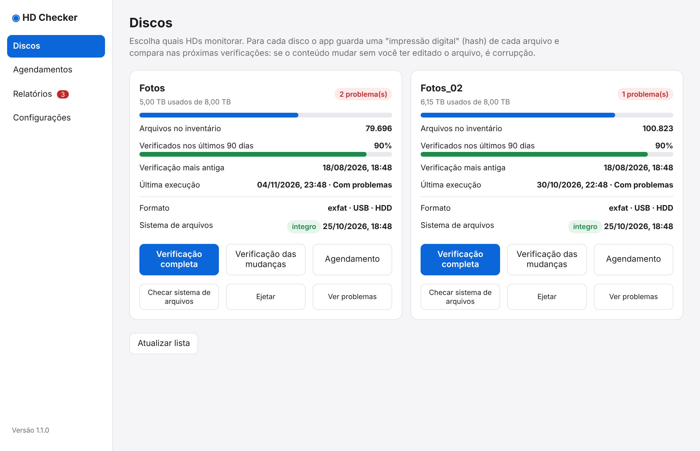

---
hide:
  - navigation
  - toc
---

# HD Checker

**Descubra que uma foto estragou enquanto o seu backup ainda guarda a versão boa.**

O HD Checker é um aplicativo gratuito e de código aberto para macOS que detecta **corrupção silenciosa de arquivos (bit rot)** nos seus HDs externos de fotos e vídeos. Ele só **lê** os discos: nunca altera nem apaga nada neles.

[:material-download: Baixar para macOS](download.md){ .md-button .md-button--primary }
[:fontawesome-brands-github: Código no GitHub](https://github.com/brunononogaki/macos_hd_checker){ .md-button }

{ loading=lazy }

## O problema

Discos externos, principalmente os sem journal como o exFAT, podem corromper arquivos sem avisar: um bit muda, um arquivo termina truncado, um vídeo perde o índice. O macOS não reclama, a foto continua no lugar, e só anos depois você abre e ela não abre mais.

O pior é que o seu backup em nuvem **copia a versão estragada** por cima da boa. Se ele guarda versões antigas por um tempo limitado (por exemplo, um ano), você tem uma janela para recuperar o arquivo. O HD Checker existe para você perceber o problema **dentro dessa janela**.

## O que ele faz

-   :material-fingerprint: **Impressão digital de cada arquivo**

    Calcula o SHA-256 de tudo e guarda num banco local. Nas verificações seguintes, se o conteúdo mudou sem o arquivo ter sido editado, é corrupção.

-   :material-file-check: **Valida a estrutura**

    Pega arquivos que já nasceram quebrados: vazios, truncados, vídeos sem índice. Entende JPEG, PNG, RAW (DNG/CR2/ARW/TIFF), MP4/MOV/CR3 e WAV.

-   :material-calendar-sync: **Verificação agendada em rodízio**

    Cada execução re-verifica uma fatia do disco, começando pelos arquivos verificados há mais tempo. Um disco de 8 TB não precisa ser relido toda semana.

-   :material-email-alert: **Avisa quando algo estraga**

    Alertas no app e por e-mail. Quando você restaura o arquivo, o alerta fecha sozinho na próxima verificação.

-   :material-harddisk: **Saúde do disco**

    Checagem do sistema de arquivos, ejeção segura mostrando quem está usando o disco, e vários discos verificados ao mesmo tempo.

-   :material-lock-open-variant: **Aberto e local**

    Tudo roda no seu Mac. Nada é enviado para a internet, exceto o e-mail de aviso que você mesmo configura.

## Comece em 5 minutos

1. [Baixe o app](download.md) e arraste para Aplicativos.
2. Abra, vá em **Discos** e clique em **Verificação completa** no disco que quer proteger.
3. Opcional: crie um [agendamento](uso/agendamentos.md) e configure o [e-mail de aviso](uso/configuracoes.md).

A primeira verificação é longa (cerca de 15 horas para 8 TB), mas só acontece uma vez, e ela [continua de onde parou](uso/discos.md#continuar-de-onde-parou) se for interrompida.
