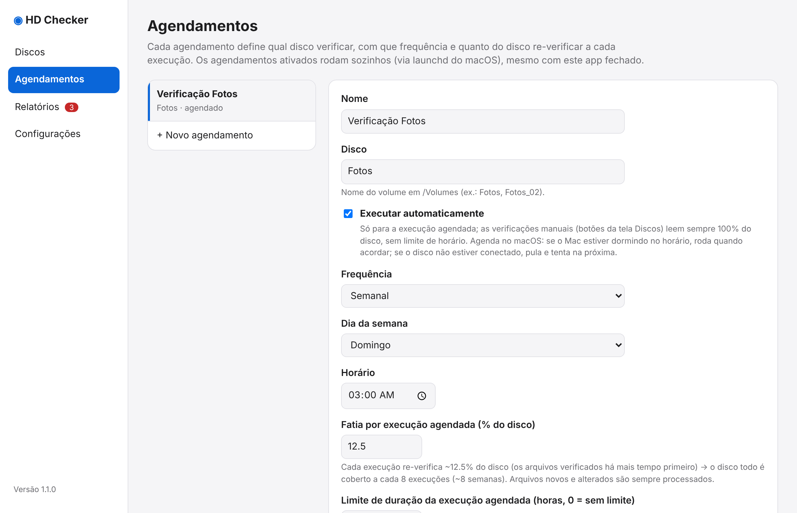

# Agendamentos

Um agendamento define **qual disco verificar, com que frequência e quanto do disco re-verificar a cada execução**. Os agendamentos ativados rodam sozinhos pelo `launchd` do macOS, **mesmo com o app fechado**.

{ loading=lazy }

## Campos

| Campo | Para que serve |
|---|---|
| **Executar automaticamente** | Liga/desliga o agendamento. Com ele desligado, os campos de frequência, dia, horário, fatia e limite ficam desabilitados. |
| **Frequência / dia da semana / horário** | Quando a verificação roda (diária ou semanal). |
| **Fatia por execução agendada (% do disco)** | Quanto do disco é re-verificado a cada execução (padrão 12,5%: o disco todo em 8 execuções). Começa pelos arquivos verificados há mais tempo. |
| **Limite de duração da execução agendada (horas)** | Termina com segurança ao atingir o tempo (0 = sem limite). A próxima execução continua. |
| **Ignorar (opcional)** | Um por linha, por exemplo `*.tmp` ou `Lixo/**`. |
| **Validar estrutura dos arquivos novos** | Confere JPEG, PNG, RAW, MP4/MOV e WAV. |
| **Aviso por e-mail** | "Só quando houver problema", "Sempre (resumo a cada execução)" ou "Nunca". |

!!! note "Fatia e limite valem só para o agendamento"
    As verificações manuais (botões da tela Discos) não dependem de nada disso: a **Verificação completa** sempre lê 100% sem limite de horário.

## Dica para a primeira catalogação

Se preferir catalogar à noite em vez de uma vez só, ligue um agendamento diário com um limite de duração (por exemplo, 8 h). A execução termina com segurança no limite e continua de onde parou na noite seguinte. Quando o inventário estiver completo, mude para semanal.

## Pastas e arquivos ignorados

O app já ignora por padrão arquivos de sistema e temporários de outros programas, como `.DS_Store`, arquivos `._*` do macOS e a pasta `.bzvol` do Backblaze. Você pode acrescentar os seus padrões no agendamento.

## Excluir um agendamento

Excluir um agendamento **não apaga** o inventário nem os relatórios do disco. O disco continua na tela Discos e você ainda pode verificá-lo manualmente.
