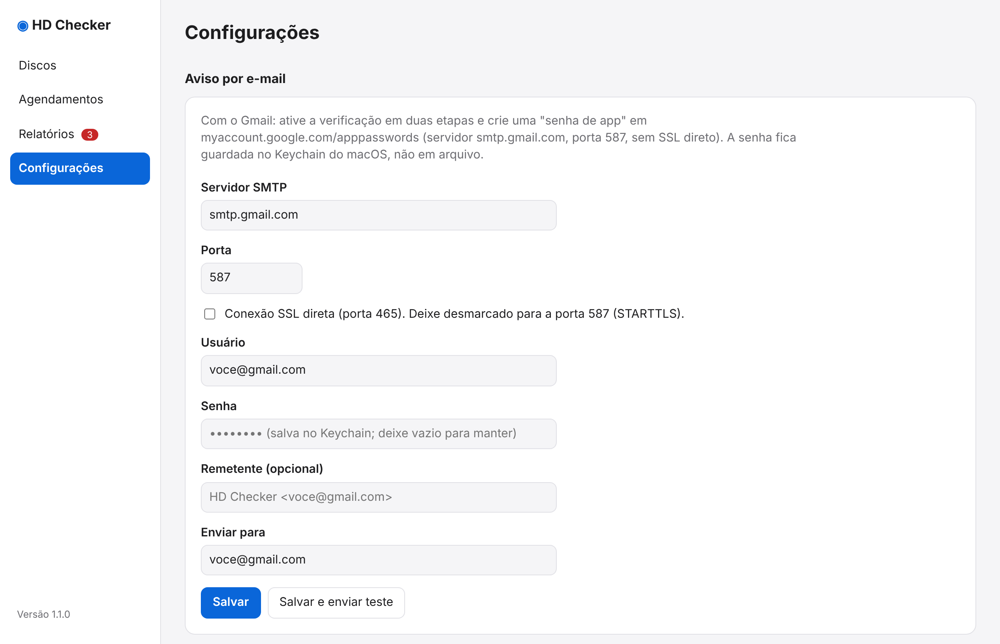

# Configurações

{ loading=lazy }

## Aviso por e-mail

Para receber um e-mail quando houver problema, informe o servidor SMTP:

| Campo | Exemplo (Gmail) |
|---|---|
| Servidor SMTP | `smtp.gmail.com` |
| Porta | `587` |
| Conexão SSL direta | desmarcado (a porta 587 usa STARTTLS; marque só para a porta 465) |
| Usuário | seu e-mail |
| Senha | uma **senha de app** |
| Remetente (opcional) | `HD Checker <voce@gmail.com>` |
| Enviar para | o e-mail que deve receber os avisos |

!!! tip "Gmail: senha de app"
    Ative a verificação em duas etapas e crie uma senha de app em `myaccount.google.com/apppasswords`. A senha fica guardada no **Keychain do macOS**, nunca em arquivo de texto.

Clique em **Salvar e enviar teste** para conferir.

## Inventário (banco de dados)

Mostra o local do banco (`inventory.db`) e o botão **Mostrar no Finder**, que abre a pasta dele. O banco fica em `~/Library/Application Support/hd_checker/`.

!!! warning "Faça backup do inventário"
    O inventário é a memória do app: sem ele, é preciso catalogar os discos de novo (horas de leitura). Inclua a pasta `~/Library/Application Support/hd_checker/` no seu backup.
