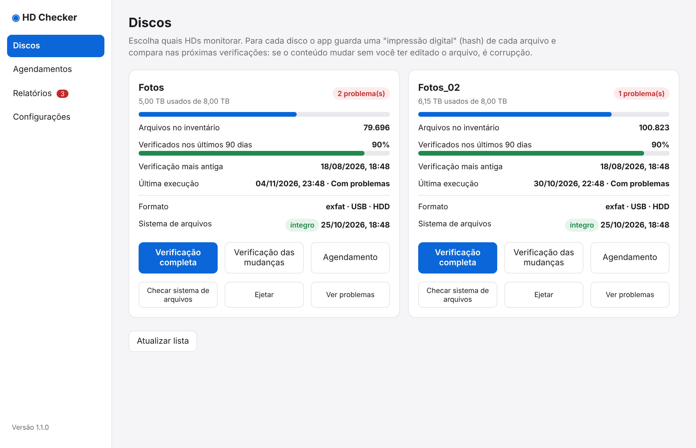

# Discos

A tela inicial mostra um card por disco: os conectados e também os desconectados que já têm inventário.

{ loading=lazy }

## O que o card mostra

- **Espaço usado** e o estado geral: *Tudo certo*, *Só avisos* ou o número de erros
- **Arquivos no inventário** e **cobertura**: quanto do disco foi verificado nos últimos 90 dias
- **Verificação mais antiga** e **Última execução**
- **Formato** (exFAT, APFS...) e a **última checagem do sistema de arquivos**

## Botões

### Verificação completa
Lê **100%** do disco, sem limite de horário e sem precisar de agendamento (se o disco não tem agendamento, o app cria um desativado). É a rodada para a primeira catalogação ou uma conferência geral.

### Continuar de onde parou { #continuar-de-onde-parou }
Aparece quando a última verificação completa foi interrompida (disco desconectado, parada manual). A nova execução pula os arquivos que as execuções interrompidas já leram e verifica só o que faltou. O card mostra quantos arquivos já foram lidos e quantos faltam.

### Verificação das mudanças
Lê apenas arquivos novos ou alterados (e os que já têm erro aberto). Use logo depois de copiar fotos para o disco.

### Agendamento
Abre o [agendamento](agendamentos.md) do disco.

### Checar sistema de arquivos
Roda `diskutil verifyVolume` (só leitura). **O macOS desmonta o disco por alguns minutos** e remonta no fim. Não roda enquanto há verificação no disco. O resultado fica em *Relatórios → Saúde dos discos*. Em exFAT, que não tem journal, vale rodar depois de qualquer desligamento sem ejetar.

### Ejetar
Usa `diskutil eject` para desconectar com segurança. Se o macOS recusar porque algum programa está usando o disco, o app mostra **quem** é (nome e PID, via `lsof`) e, com a sua confirmação, pede que os programas do seu usuário terminem (SIGTERM, nunca à força; nunca processos de root, do `launchd` nem o próprio app) e tenta ejetar de novo.

!!! warning
    Não use "pedir para encerrar" se algo estiver copiando arquivos para o disco.

### Ver problemas
Abre *Relatórios* já filtrado para esse disco.

## Acompanhando uma verificação

Enquanto uma verificação roda, um banner no topo mostra o andamento (arquivos, bytes, velocidade e tempo restante) e o título da janela mostra a porcentagem. Execuções **agendadas** que rodam em segundo plano também aparecem ali.
