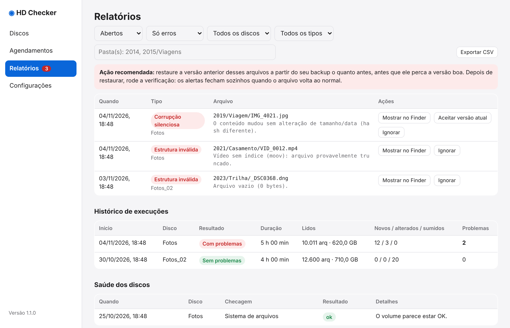

# Relatórios

Aqui ficam os alertas, o histórico de execuções e a saúde dos discos.

{ loading=lazy }

## Filtros

Filtre por **estado** (abertos, resolvidos, todos), **gravidade** (erros, avisos), **disco**, **tipo** (por exemplo, "Arquivo sumiu") e **pasta**. O botão **Exportar CSV** exporta exatamente o que os filtros mostram, sem limite de linhas.

## Tipos de alerta

| Tipo | Significado | Gravidade |
|---|---|---|
| Corrupção silenciosa | Mesmo tamanho e data, hash diferente | Erro |
| Estrutura inválida | Arquivo novo vazio, truncado ou sem índice | Erro |
| Erro de leitura | Falha de leitura (EIO): possível setor ruim | Erro |
| Arquivo sumiu | Existia no inventário e não está mais no disco | Aviso |

## O que fazer com um alerta { #o-que-fazer-com-um-alerta }

1. **Restaure a versão anterior** do arquivo a partir do seu backup, o quanto antes, antes que ele perca a versão boa.
2. Rode uma verificação. Quando o arquivo volta ao normal, **o alerta fecha sozinho**.
3. Se você editou o arquivo de propósito, use **Aceitar versão atual** para adotar o conteúdo novo como o original.

Outros botões por alerta: **Mostrar no Finder** e **Ignorar**.

## Limpar "Arquivo sumiu" em lote

Se você apagou ou moveu pastas inteiras de propósito, não precisa resolver arquivo por arquivo:

1. No filtro de tipo, escolha **Arquivo sumiu**.
2. Escolha o disco.
3. No campo de pasta, digite uma ou mais pastas separadas por vírgula, por exemplo `2014, 2015/Viagens`. Vale para tudo dentro delas.
4. Clique em **Foi apagado de propósito — todos**. O app mostra o total e pede confirmação.

Os alertas ficam registrados como resolvidos ("apagado de propósito, em lote") e os arquivos saem do inventário.

## Histórico de execuções e saúde dos discos

Abaixo dos alertas há a lista de execuções (início, disco, resultado, duração, arquivos lidos, novos/alterados/sumidos e problemas). Clicar numa execução filtra os alertas dela. Execuções em andamento aparecem ao vivo. A seção **Saúde dos discos** guarda o histórico das checagens do sistema de arquivos (do botão **Checar sistema de arquivos**).
